# related --mode graph 性能优化(冷 3s / 热 200ms)

**日期**:2026-07-12
**关联实验**:`experiments/related_perf_2026_07_12/`(SPEC/QUESTIONS/FINDINGS + 10 变体 × 3 seed 组数据)
**动机**:生产实测 `related --mode graph` 冷启动 109.7s、热启动 48.1s。核心瓶颈:PPR 是纯 Python 幂迭代跑
在 310 万边的全图上,加载路径每边做 id↔文本往返 casefold,`build_adjacency` 冷启动构建但热路径完全不用,
doc 聚合用 `k.kw IN (60词)` 的文本 IN 逼 SQLite 放弃 keyword_chunks 主键路径。

**实验结论**:7 项优化叠加把冷启动从 68s(bench)→ 3.1s(-95.5%),生产热启动预期 ~200ms。top-20 结果
Jaccard = 1.0 保序,backend 等价性 1.0,契约不变,无 scipy 依赖。

---

## 0. TL;DR

| 优化 | 层次 | 单项收益(bench hub warm_p50) | 落地风险 |
|---|---|---|---|
| **P2.3** doc-agg id-native(⭐️) | doc 聚合 | **-78%**(13.9s → 3.1s) | 低,新函数 + dispatch |
| **P3** numpy CSR + `np.bincount` backend | PPR 幂迭代 | **-46%**(35.8s → 19.5s) | 可选依赖,`auto` 检测 |
| **P1.2** `min_npmi=0.2` 默认 | 加载边 SQL WHERE | **-38%**(61.6s → 38.1s) | 语义微变:trace-signals 补版本 |
| **P2.2** id-native 图构建 | 加载边 + 建图 | -5%(37.6s → 35.8s) | 低,是 P2.3 的必要前置 |
| **P1.1** stopword ∪ core_boundaries | 建图阶段 | -10%(68.1s → 61.6s) | 建图代码复用已有 26 字集合;需 rebuild 一次 |
| **P2.1** 删热路径 `build_adjacency` | adjacency_cache | -1% 噪声内(生产 ~2.7s 净) | 零风险,adjacency_cache miss 才有净收益 |
| P1.4a `edge_quantile` 便捷入口 | 加载边(糖) | 派生 | opt-in,不改默认 |

**建议主干落地顺序**:P2.3 → P3 → P2.2(P2.3 前置) → P1.2 → P2.1 → P1.1;P1.4a 单独;`P4 Forward Push`
归档到 `docs/design/future/`(PPR 已 96ms,不需要)。

---

## 1. 设计约束

### 1.1 契约冻结点(重构后必须字节级一致)

- `related --json` 每个字段:`doc_path`, `keywords[]`, `directory`, `qualified_path`,
  `graph_signals{seed_chunk_df, total_chunks_in_scope, neighbor_edges[{a,b,npmi,cooccur_count,source}]}`
- `related --json crossed_scopes_preview` 字段结构
- `trace-signals v1` 的 `graph_actions` 输出词汇表和 node 前缀
- `deep_search --json` 里 `history[].keywords`(P2.2 涉及 kw 内部换 id,但对外仍是字符串)

### 1.2 允许改动范围

- 所有内部 SQL 查询与内部 API 参数
- CLI 增加 `--min-npmi` `--edge-quantile` 参数(现有参数不改)
- `adjacency_cache` 返回值从 `(edges, adj, indexed)` 3-tuple 改为 `(edges, None, indexed)` 3-tuple
  兼容(dict adj 位保留 `None`,不破坏 tests 解包语法)

### 1.3 非目标

- **不做**:build 阶段的 `_STOPWORDS` 扩展评审(P1.1 只是复用 `_CORE_STOP_BOUNDARIES` 里已存在的 26 字)
- **不做**:P4 Forward Local Push(实验证明 PPR 已 96ms,不需要)
- **不做**:scipy 依赖(numpy CSR 手写三数组即可)
- **不动**:数据库 schema(v5 已足够;P2.3 依赖的 `(kw_id, doc_id, chunk_id)` 复合主键已存在)

---

## 2. 落地阶段(独立可交付、独立可回滚)

```mermaid
flowchart LR
    S["生产基线<br/>冷 109.7s / 热 48.1s"]
    P23["P2.3 doc-agg id-native<br/>doc_agg 11s→53ms"]
    P22["P2.2 id-native 图构建<br/>P2.3 前置数据结构"]
    P3["P3 numpy CSR + bincount<br/>PPR 35s→96ms"]
    P12["P1.2 min_npmi=0.2 默认"]
    P21["P2.1 删 build_adjacency"]
    P11["P1.1 stopword union"]
    T["目标:冷 3s / 热 200ms<br/>正确性 Jaccard=1.0"]

    S --> P22
    P22 --> P23
    P23 --> P3
    P3 --> P12
    P12 --> P21
    P21 --> P11
    P11 --> T
```



**每阶段独立 PR**,理由:

- P2.3 单项收益最大但 P2.2 前置(kw_id 一路贯通),两阶段 PR 顺序不能颠倒;可合并成一个 PR 也可
- P3 是可选依赖引入,单独评审
- P1.2 涉及默认值改动 + trace-signals 语义微变声明,单独评审
- P2.1/P1.1 是清理性质,零风险,可以打包

### 2.1 P2.2 · id-native 图构建(P2.3 前置)

**文件**:`src/grga/graph/ppr.py`, `src/grga/graph/adjacency_cache.py`

**改动**:
- 新增 `load_edges_indexed(conn, *, directory, min_npmi=0) -> (IndexedGraph, Dict[int, str])`:
  - 直接 `SELECT kw_a_id, kw_b_id, source, cooccur_count, npmi FROM keyword_pairs WHERE ...`
  - 无 JOIN,无 casefold
  - 内部用 int 键聚合;最后 `SELECT id, kw FROM keywords WHERE id IN (...)` 批量翻译
  - **`IndexedGraph.node_ids` 保持 str 数组**(方案 2a):trace/signals/输出零改动
- 保留原 `load_edges` 作为 legacy 出口(测试用)
- `adjacency_cache._cached_adjacency` 改用 `load_edges_indexed`,不再构建 dict adjacency,返回 `(edges, None, indexed)`

**契约**:对外 `graph_signals.neighbor_edges` 里 `a`/`b` 仍是字符串,不变。

**测试变更**:`tests/graph/test_adjacency_cache.py` 里 3 处 `_, adj, idx = get_adjacency(...)` 需要
适配 `adj=None`(改为 `_, _, idx = get_adjacency(...)` 或 `res = get_adjacency(...); idx = res[2]`)。

### 2.2 P2.3 · doc 聚合 id-native(最大单项收益)

**文件**:`src/grga/related.py`(或新增 `src/grga/graph/doc_agg.py`)

**改动**:
```python
def _aggregate_docs_id_native(conn, dir_id, kw_score: Dict[str, float]) -> List[dict]:
    # Step 1: batch kw text -> kw_id (small IN, <10ms)
    kw_texts = list(kw_score.keys())
    ph = ",".join("?" * len(kw_texts))
    kw_id_to_text = {int(r[0]): r[1] for r in conn.execute(
        f"SELECT id, kw FROM keywords WHERE kw IN ({ph})", kw_texts)}

    # Step 2: id-native aggregation — hits keyword_chunks composite PK
    kw_ids = list(kw_id_to_text.keys())
    ph_id = ",".join("?" * len(kw_ids))
    rows = conn.execute(
        "SELECT kc.doc_id, kc.kw_id, SUM(kc.occurrence_count) AS total "
        "FROM keyword_chunks kc JOIN docs d ON d.id = kc.doc_id "
        f"WHERE kc.kw_id IN ({ph_id}) AND d.dir_id = ? "
        "GROUP BY kc.doc_id, kc.kw_id",
        kw_ids + [dir_id])

    # Step 3: score + batch doc_id -> doc_path
    ...  # same aggregation math (log1p damping preserved)
```

**关键洞察**:`SEARCH kc USING PRIMARY KEY (kw_id=? AND doc_id=?)` — SQLite 直接走
`keyword_chunks(kw_id, doc_id, chunk_id)` 复合主键 range scan,60 次独立扫描比
"扫全 dir_id 的 docs → 逐 chunk JOIN keywords" 快 200-900×(实测 10,396ms → 37ms)。

**契约**:输出 `List[{"doc_path": str, "score": float}]` 与旧 `aggregate_docs` **逐位一致**
(实验 top-20 Jaccard = 1.0 已验证)。

**跨 scope 场景**:`JOIN docs` 保证 `d.dir_id = ?` 过滤,与现在 `related --scope` 语义完全一致。
测过单 scope 场景,概念验证不带 `JOIN docs` 是 11.5ms,带是 37ms;跨 scope 大数据集下 JOIN 成本会
上升,但仍远小于旧路径的 10s+。

### 2.3 P3 · numpy CSR + `np.bincount` backend

**文件**:`src/grga/graph/ppr.py`(新增 backend 层)

**改动**:
```python
try:
    import numpy as np
    _HAS_NUMPY = True
except ImportError:
    np = None
    _HAS_NUMPY = False

def _select_backend(n_edges: int) -> str:
    env = os.environ.get("GRGA_PPR_BACKEND", "auto")
    if env == "py": return "py"
    if env == "numpy":
        if not _HAS_NUMPY: raise RuntimeError(...)
        return "numpy"
    return "numpy" if _HAS_NUMPY and n_edges >= 50_000 else "py"

def _csr_from_indexed(graph) -> (n, indptr, indices, data, out_degree):
    # 手写三数组,不引 scipy;详见 experiments/.../bench.py 参考实现

def _ppr_numpy(seed_ids, csr, alpha, iters):
    # 关键:SpMV 用 np.bincount,不用 np.add.at(10-100× 差)
    #   new_score = alpha * personal + np.bincount(indices, weights=contrib, minlength=n)
    # 关键:tie-break 与 py 版一致(-score, node_id 字典序)
    #   argsort prefilter → Python sort with key=(-score, node_id)
```

**依赖**:`numpy` 加入 `pyproject.toml` 的 `optional-dependencies`(如 `[project.optional-dependencies] perf = ["numpy>=1.20"]`),
用户 `pip install grga[perf]` 或系统本地已装均可。**不进 install_requires**——保持零必需依赖。

**契约**:PPR 输出的 top-k `List[(str, float)]` 与 py 版逐位一致(实验验证 Jaccard = 1.0,含 tie-break 一致)。

**graph_signals 诊断字段**(可选,按 AGENTS.md §信号暴露原则第 1 条,派生信息,不加):
- 不新增 `ppr_backend_used` 字段;用户从耗时能推断,加字段是净累赘

### 2.4 P1.2 · `min_npmi` 参数化 + 默认 0.2

**文件**:`src/grga/graph/ppr.py`(`load_edges_indexed`), `src/grga/related.py`(参数透传), `src/grga/cli.py`(`--min-npmi`)

**改动**:
- `load_edges_indexed(..., min_npmi: float = 0.2)`:SQL WHERE 增 `AND (source != 'chunk_cooccur' OR npmi >= ?)`
- `edge_weight`:chunk_cooccur 边去掉 `0.01 * log1p(count)` 地板(与 npmi 阈值语义冲突),
  llm_promoted 边保持 `log1p(count)`(其 npmi 常 NULL)
- CLI:`grga related --min-npmi FLOAT`(默认 0.2)+ env `GRGA_PPR_MIN_NPMI`
- `adjacency_cache` key 增 `min_npmi` 维度,不同阈值不串扰

**默认值 0.2 的证据**(实验 F4):
- npmi=0.1:PPR top-10 = 我 / 说道 / 若 / 能 / 会 / ...(**被功能词污染**)
- npmi=0.2:PPR top-10 = 元 / 修炼 / 婴 / 修为 / 后期 / 炼制 / ...(**全语义词**)
- doc Jaccard 与 npmi=0 baseline = 1.0(recall 无损)

**契约微变**:`graph_signals.neighbor_edges` 门槛从"任何非零权重"提高到"npmi ≥ 0.2",
需在 `docs/design/trace-signals.md` 补版本说明(仍是同 schema,非 breaking)。

### 2.5 P2.1 · 删热路径的 `build_adjacency`

**文件**:`src/grga/graph/adjacency_cache.py`

**改动**:`_cached_adjacency` 只构建 `IndexedGraph`,`build_adjacency(edges)` 调用移除。
`get_adjacency(...)` 返回 `(edges, None, indexed)` 保持 3-tuple 兼容(测试解包语法)。

**保留**:`build_adjacency` / `indexed_graph_from_adjacency` / `personalized_pagerank`(dict 版)
函数本身**保留**(单元测试 `tests/test_ppr.py` 里 6 处 caller 依赖)。只是**从热路径缓存里删了构建调用**。

**收益**:生产 310 万边上 build_adjacency ~2.7s,adjacency_cache miss 时净省;命中时本就是缓存命中,不受影响。
实验小图(1.27M 边)上收益被噪声淹没(-1%),但零风险,值得做。

### 2.6 P1.1 · stopword union(建图侧)

**文件**:`src/grga/graph/build.py`

**改动**:
```python
_INDEX_STOPWORDS = _STOPWORDS | _CORE_STOP_BOUNDARIES  # 新增

def _keywords_from_tokens(tokens):
    for tok in tokens:
        key = tok.casefold()
        if key in _INDEX_STOPWORDS:  # 从 _STOPWORDS 改为 _INDEX_STOPWORDS
            continue
        ...
```

**语义分层保留**:`_CORE_STOP_BOUNDARIES` 仍只用于 `detect_ngram_phrases` 的边界(保证"面壁**者**"不被截断),
索引层是**订阅**它,不是替代。detection/index 两层的语义分层设计不变,只是索引层多消费一个源头集合。

**收益边界**:只清单字结构虚词(在/是/也/就/但/这/有/都...共 14 个 hub 里的),
多字虚词 hub(没有/说道/什么/知道)靠 P1.2 min_npmi 兜底。

**代价**:需要一次 `grga index build --rebuild`(几分钟到几十分钟),用户显式触发。
契约上索引数据变小,graph_signals 数值随之变化。

### 2.7 P1.4a · `edge_quantile` 便捷入口(opt-in)

**文件**:`src/grga/graph/ppr.py`(新增 `_resolve_quantile_cutoff`), `src/grga/related.py`(参数处理), `src/grga/cli.py`

**改动**:
- `related --edge-quantile FLOAT`(0-1,保留 top X% 边);与 `--min-npmi` 互斥,同给报 exit 2
- 内部实现:`(kw_a_id + kw_b_id) % step = 0` 采样 10 万行,Python 排序取分位点,再走 P1.2 通路
- 采样耗时 500ms 量级,不影响缓存

**为什么保持 opt-in**:AGENTS.md §信号暴露原则第 1 条,caller 能从 min_npmi 派生 quantile 语义
(自己查一次分位点),说明 quantile 是**便利性 API**,不是核心机制。默认走 min_npmi=0.2。

---

## 3. 契约影响清单

| 契约位 | 影响 | 处理 |
|---|---|---|
| `related --json` 顶层字段 | 无变化 | — |
| `graph_signals` schema | 无变化 | — |
| `graph_signals.neighbor_edges` 阈值语义 | 门槛从 0 提到 npmi≥0.2 | `docs/design/trace-signals.md` 补版本说明 |
| `graph_actions` 词汇表 | 无变化 | — |
| exit codes | 增 `--min-npmi` / `--edge-quantile` 互斥 exit 2 | `docs/exit-codes.md` 无需改(usage error 已覆盖) |
| `--json` 错误 emit | 无变化 | — |
| `adjacency_cache` 内部 return type | `(edges, None, indexed)` | 无外部消费者;3 处测试解包适配 |
| `pyproject.toml` | 加 `[project.optional-dependencies].perf = ["numpy>=1.20"]` | 不进 `install_requires` |

**AGENTS.md HC2 无语料先验合规性**:全部优化都是数学信号(npmi 显著性检验、已有词表复用、
SQL 执行计划优化、算法后端替换),无新增语料先验。

---

## 4. 测试策略

### 4.1 单元测试新增

- `tests/graph/test_ppr_numpy_backend.py`:numpy 版和 py 版在同一随机图上 top-20 keyword Jaccard = 1.0(tie-break 一致)
- `tests/graph/test_doc_agg_id_native.py`:旧 `aggregate_docs` 与新 `_aggregate_docs_id_native` 输出 `doc_path` 集合完全一致,score 差 < 1e-9
- `tests/test_related_min_npmi.py`:`--min-npmi 0.2` 结果与 `--min-npmi 0` baseline 的 Jaccard ≥ 0.85(允许语义收紧带来的部分换血)

### 4.2 现有测试适配

- `tests/graph/test_adjacency_cache.py`:3 处 `_, adj, idx` 解包中 `adj` 变为 `None`,断言用 `idx` identity
- `tests/test_ppr.py`:**不动**(测的是保留下来的 legacy dict API)

### 4.3 Bench 回归

- `bench/related_perf.py`(新增,从 experiments 提炼):3 档 seed × VF vs V0 对比,防止未来回退
- 在 CI 里跑 quick 变体(seed=1 个 hub 词,VF only),阈值 < 5s

---

## 5. 回滚路径

| 阶段 | 回滚方式 |
|---|---|
| P2.2 | 保留 `load_edges` legacy,读路径可 revert;`get_adjacency` 返回类型是 3-tuple,`adj` 位改回 `build_adjacency(edges)` |
| P2.3 | 新增函数,dispatch 处 `if os.environ.get("GRGA_DOC_AGG_LEGACY")` 走旧版 |
| P3 | env `GRGA_PPR_BACKEND=py` 强制纯 Python |
| P1.2 | `related --min-npmi 0` 或 env `GRGA_PPR_MIN_NPMI=0` 恢复旧行为 |
| P2.1 | 无 caller,无需回滚点 |
| P1.1 | `grga index build --rebuild` 用旧代码重建 |
| P1.4a | 不给 `--edge-quantile` 即回旧行为 |

---

## 6. 落地检查清单

- [ ] P2.2 落地 PR:`load_edges_indexed` + `adjacency_cache` 改造 + 3 处测试解包适配
- [ ] P2.3 落地 PR:`_aggregate_docs_id_native` + related.py dispatch + 新 unit test
- [ ] P3 落地 PR:`_csr_from_indexed` + `_ppr_numpy` + backend 选择 + optional-dependency 声明 + 新 unit test
- [ ] P1.2 落地 PR:`load_edges_indexed(min_npmi=)` + CLI `--min-npmi` + adjacency_cache key + trace-signals.md 版本说明
- [ ] P2.1 落地 PR(可并入 P2.2):`_cached_adjacency` 不再构建 dict adj
- [ ] P1.1 落地 PR:`_INDEX_STOPWORDS` union + rebuild 文档
- [ ] P1.4a 落地 PR(可选,可延后):`_resolve_quantile_cutoff` + CLI `--edge-quantile`
- [ ] `bench/related_perf.py` 从 experiments/related_perf_2026_07_12 提炼进主干
- [ ] 生产真实数据集上复测,验证冷 <3s、**热 <500ms**(实验预期 ~200ms,须实测)
- [ ] `docs/navigation.md` 更新:P3 引入 backend 层入口,P2.3 引入 doc_agg id-native 入口
- [ ] `CHANGELOG.md` 记录性能提升数字 + `--min-npmi` 新参数

---

## 7. 已知遗留 / 后续实验候选

1. **主干真实 adjacency_cache 热启动复测**:bench 局限是没跨 run 复用 adjacency,生产热启动预期
   ~200ms 由实验 F7 外推,须落地后复测
2. **build-side P1.1 rebuild 实测**:本实验 SQL WHERE 模拟,rebuild 后 `keyword_chunks` / `keyword_pairs`
   规模变化待测(应比 SQL WHERE 更多受益,因为 npmi 会以更干净的语料重算)
3. **跨 scope P2.3 验证**:本实验 db 单 scope;跨 scope 场景 `docs JOIN` 开销概念验证是 37ms(vs 11ms),
   大数据集下需要复测

---

## 8. 一句话给未来读者

**本方案由 experiments/related_perf_2026_07_12 的三轮迭代(v1 首跑 → v2 code review 修正 6 处测量偏差
→ v3 加入 P2.3 突破 F1 doc-agg 瓶颈)得出。最大意外收获是 P2.3 不在原始方案里,是 v2 阶段 PPR 加速后
才浮出水面的新瓶颈(Amdahl's law 的"尾巴变头")。这提醒:多阶段性能优化的方案必须允许"实验催生新阶段",
不能一次性 freeze 全部阶段。**
